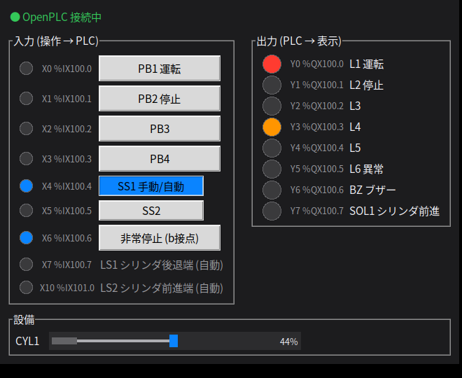

# gazebo-kentei — 仮想検定くん

OpenPLC Runtime と ROS 2 で、**ラダー / ST プログラムを実機なしで事前確認する**ための環境です。

押しボタン・セレクトスイッチ・センサ・ランプ・ブザー・シリンダを持つ「仮想検定くん」を ROS 2 ノードとして動かし、
OpenPLC からは Modbus/TCP のリモート I/O として見せます。`ros2 launch` 1 回で OpenPLC ごと起動します。

```
   OpenPLC Runtime (ラダー / ST, Web 画面 :8080)
        │  Modbus/TCP :5020  (OpenPLC がマスタとして 20 ms ごとに読み書き)
        ▼
   kentei_io_server   仮想 I/O + シリンダモデル
        │  ROS 2 トピック  kentei/cmd/*, kentei/state/*
        ▼
   kentei_panel (操作パネル GUI) / 自動テスト / Gazebo など
```

- OpenPLC は `third_party/OpenPLC_v3` に git サブモジュールとして取り込んでいます (バージョン固定)。
- 仮想検定くんの I/O は YAML (`config/kentei_io.yaml`) で自由に変更できます。
- ROS 2 トピック経由で操作・確認できるので、**動作確認の自動テスト**も書けます。

動作確認環境: Ubuntu 24.04 + ROS 2 Jazzy

## セットアップ

```bash
# 1. サブモジュール (OpenPLC) ごと取得
git clone --recursive https://github.com/taku0310/gazebo-kentei.git
cd gazebo-kentei
# (--recursive を付け忘れた場合: git submodule update --init)

# 2. OpenPLC をビルド (sudo を使います。5〜15 分程度)
./scripts/setup_openplc.sh
echo "export OPENPLC_DIR=$PWD/third_party/OpenPLC_v3" >> ~/.bashrc

# 3. ROS 2 パッケージをビルド
source /opt/ros/jazzy/setup.bash
cd ros2_ws
rosdep install --from-paths src -y --ignore-src   # python3-tk など
colcon build --symlink-install
source install/setup.bash
```

> `setup_openplc.sh` は、OpenPLC のインストーラが登録する自動起動サービス (`openplc.service`) を無効にします。
> ここでは `ros2 launch` から起動するため、ポートが二重に使われないようにしています。

## 起動

```bash
source ros2_ws/install/setup.bash
ros2 launch kentei_sim kentei_sim.launch.py program:=$PWD/plc_programs/kentei_sample.st
```

1. 指定した ST ファイルを OpenPLC に書き込んでコンパイルします (初回は 30 秒ほどかかります)
2. OpenPLC Runtime を RUN モードで起動します
3. 操作パネルが開き、上部が「● OpenPLC 接続中」になれば準備完了です



`program:=` を省略すると、前回書き込んだプログラム (または Web 画面で選んだプログラム) で起動します。
OpenPLC の Web 画面は http://localhost:8080 (ユーザー / パスワード: `openplc` / `openplc`) です。
**Monitoring** で変数の値をリアルタイムに確認できます。

| launch 引数 | 既定値 | 内容 |
|---|---|---|
| `program` | (空) | 起動前に書き込む ST ファイル (絶対パス) |
| `openplc_dir` | `$OPENPLC_DIR` | OpenPLC_v3 のディレクトリ |
| `config` | `kentei_io.yaml` | I/O 定義 YAML |
| `start_openplc` | `true` | `false` で OpenPLC を起動しない (別 PC や Docker で動かす場合) |
| `gui` | `true` | `false` で操作パネルを出さない (自動テスト用) |
| `polling` | `20` | OpenPLC が I/O を読み書きする周期 [ms] |
| `openplc_modbus_port` | `5502` | OpenPLC 自身の Modbus サーバのポート (HMI 等から接続する場合) |

## 自分のラダーを確認する手順

1. **OpenPLC Editor** でプロジェクトを作り、LD (ラダー) で POU を作成します
2. 変数の Location に下の対応表のアドレスを入れます (例: `PB1` → `%IX100.0`、`L1` → `%QX100.0`)
   - 変数宣言は次のコマンドでまとめて出せます (ST にはそのまま貼れます)
     ```bash
     ros2 run kentei_sim kentei_openplc vars --config ros2_ws/src/kentei_sim/config/kentei_io.yaml
     ```
3. Editor の **Generate program for OpenPLC Runtime** で `.st` ファイルを書き出します
4. `ros2 launch kentei_sim kentei_sim.launch.py program:=/path/to/書き出した.st` で起動します
5. 操作パネルでボタンを押して動作を確認します

ST で直接書く場合は、`plc_programs/kentei_sample.st` をひな形にしてください (最後の `CONFIGURATION` ブロックが必要です)。

### I/O 対応表 (既定の `kentei_io.yaml`)

| 信号 | 実機デバイス | OpenPLC | 種類 | 内容 |
|---|---|---|---|---|
| PB1 | X0 | `%IX100.0` | momentary | PB1 運転 |
| PB2 | X1 | `%IX100.1` | momentary | PB2 停止 |
| PB3 | X2 | `%IX100.2` | momentary | PB3 |
| PB4 | X3 | `%IX100.3` | momentary | PB4 |
| SS1 | X4 | `%IX100.4` | alternate | SS1 手動/自動 |
| SS2 | X5 | `%IX100.5` | alternate | SS2 |
| EMG | X6 | `%IX100.6` | momentary (b接点) | 非常停止 (b接点) |
| LS1 | X7 | `%IX100.7` | sensor | LS1 シリンダ後退端 |
| LS2 | X10 | `%IX101.0` | sensor | LS2 シリンダ前進端 |
| L1 | Y0 | `%QX100.0` | lamp | L1 運転 |
| L2 | Y1 | `%QX100.1` | lamp | L2 停止 |
| L3 | Y2 | `%QX100.2` | lamp | L3 |
| L4 | Y3 | `%QX100.3` | lamp | L4 |
| L5 | Y4 | `%QX100.4` | lamp | L5 |
| L6 | Y5 | `%QX100.5` | lamp | L6 異常 |
| BZ | Y6 | `%QX100.6` | buzzer | BZ ブザー |
| SOL1 | Y7 | `%QX100.7` | solenoid | SOL1 シリンダ前進 |

- アドレスが `%IX0.0` ではなく `%IX100.0` から始まるのは、OpenPLC が外部 Modbus 機器 (スレーブデバイス) の I/O を 100 番台に割り当てる仕様のためです。
- 「実機デバイス」列は本番 PLC (三菱なら X/Y) との対応メモです。YAML の `label` で変更できます。
- 表は `ros2 run kentei_sim kentei_openplc table --config <yaml>` で作り直せます。

### I/O 構成を変える

`ros2_ws/src/kentei_sim/config/kentei_io.yaml` を編集します (コピーして `config:=` で指定しても構いません)。

- 入力: `momentary` (押しボタン) / `alternate` (切替スイッチ) / `sensor` (設備モデルが動かすか、手動で切り替え)。`normally_closed: true` で b 接点
- 出力: `lamp` (`color` で色を指定) / `buzzer` / `solenoid` / `motor`
- `plant.cylinders`: 出力に応じて前進端・後退端センサを自動で切り替える仮想シリンダ (単動 / 複動)

## サンプルプログラムと自動テスト

`plc_programs/kentei_sample.st` は、自己保持、手動・自動の切替、シリンダの 3 サイクル運転、タイマ、フリッカ、
異常検出、非常停止を含むサンプルです (仕様はファイル先頭のコメントにあります)。

`plc_programs/check_kentei_sample.py` は、ROS 2 トピック経由でボタンを操作し、ランプ等が仕様どおりに変わるかを自動で判定します。

```bash
# 端末 1
ros2 launch kentei_sim kentei_sim.launch.py program:=$PWD/plc_programs/kentei_sample.st gui:=false
# 端末 2
python3 plc_programs/check_kentei_sample.py
#   [2] 手動運転 (SS1 OFF)
#     OK   PB1 で運転 L1 点灯
#     ...
#   結果: 合格
```

`scenario()` を書き換えれば、自分の課題用のテストとして使えます。

## ROS 2 インタフェース

| トピック | 型 | 向き | 内容 |
|---|---|---|---|
| `kentei/cmd/<入力名>` | `std_msgs/Bool` | → I/O サーバ | 操作 (押した / 入れた = `true`)。b 接点の反転は I/O サーバ側で行う |
| `kentei/state/<信号名>` | `std_msgs/Bool` | I/O サーバ → | PLC が見ている入力値 / PLC からの出力値 (transient local) |
| `kentei/plant/<設備名>/position` | `std_msgs/Float32` | I/O サーバ → | シリンダ位置 0.0 (後退端) 〜 1.0 (前進端) |
| `kentei/plc_connected` | `std_msgs/Bool` | I/O サーバ → | OpenPLC からのポーリングが届いているか |

コマンドラインからも操作できます。

```bash
ros2 topic pub --once /kentei/cmd/PB1 std_msgs/Bool "{data: true}"
ros2 topic echo /kentei/state/L1
```

## 注意点

- **本番機種とは書式が違います。** OpenPLC は IEC 61131-3 準拠のため、三菱 / オムロン / キーエンス等のラダーとはデバイス名や命令が異なります。
  ここで確認できるのは**ロジック (動作の流れ)** です。本番の機種向けには書き直しが必要です。
- **タイミング**: I/O は既定 20 ms 周期でやり取りします。数 ms 以下の短いパルスは再現できません。手で操作するレベルの課題なら問題ありません。
- **使用ポート**: 8080 (OpenPLC Web 画面)、5020 (仮想検定くん Modbus)、5502 (OpenPLC 自身の Modbus サーバ。
  一般ユーザーでは 502 番を使えないため、launch 時に 5502 に設定しています。launch 引数 `openplc_modbus_port` で変更可)。

## トラブルシューティング

| 症状 | 確認すること |
|---|---|
| パネルが「OpenPLC 未接続」のまま | OpenPLC の Web 画面が開けるか / PLC が Running か / **Slave Devices** に `kentei_kun` (127.0.0.1:5020) があるか |
| `openplc_load が失敗しました` | 上に表示される ST のコンパイルエラーを確認する (`step` などの予約語を変数名にしていないか、`;` が抜けていないか) |
| ポート 8080 が使用中 | 別の OpenPLC が動いていないか (`sudo systemctl status openplc`) |
| ボタンを押しても PLC の入力が変わらない | 変数のアドレスが `%IX100.x` になっているか (`%IX0.x` ではない) |

## ディレクトリ構成

```
third_party/OpenPLC_v3/        OpenPLC Runtime (git サブモジュール, GPL-3.0)
scripts/setup_openplc.sh       OpenPLC のビルド
plc_programs/                  サンプル ST と自動テスト
ros2_ws/src/kentei_sim/
  config/kentei_io.yaml        I/O 定義
  launch/kentei_sim.launch.py  一括起動
  kentei_sim/
    io_server_node.py          仮想 I/O (Modbus スレーブ + ROS 2 トピック + 設備モデル)
    panel_node.py              操作パネル GUI
    openplc_tool.py            kentei_openplc コマンド (OpenPLC の設定・書き込み・起動)
    modbus_slave.py            Modbus/TCP スレーブ (外部ライブラリ不要)
    plant.py                   シリンダモデル
```
